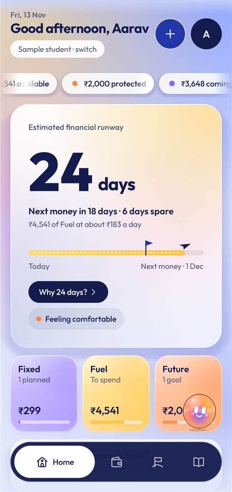
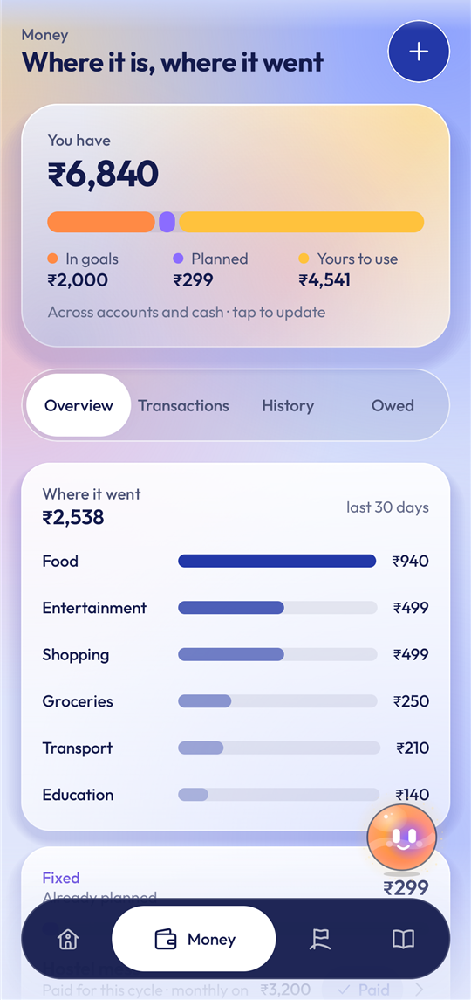
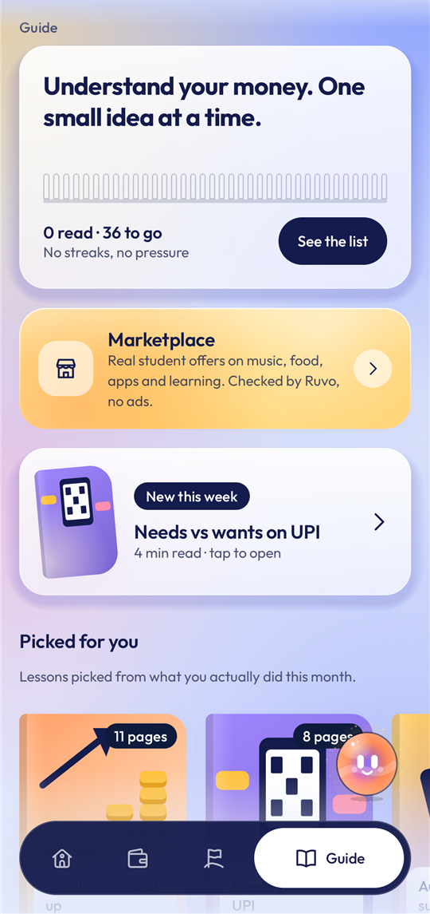

# Ruvo

**A student money companion for India that answers one question: how many days will my money last?**

Final-year UI/UX project by Kumkum Bharambe · Native Android app (Kotlin, Jetpack Compose)

<p align="center">
  <a href="https://github.com/kumkum-bharambe/RUVO/releases/latest/download/Ruvo.apk"><b>⬇ Download the Android app (Ruvo.apk)</b></a>
  <br>
  Open this page on an Android phone and tap the link above. About 42 MB · Android 8 or newer · free.
</p>

<p align="center">
  
  <br><sub>Or scan this with the phone's camera.</sub>
</p>

**New to installing apps from outside the Play Store?** Follow the
[step-by-step install guide](docs/INSTALL.md). It takes about five minutes and needs no computer.

---

## What Ruvo does

Most money apps show a balance. Ruvo turns it into **days**: "24 days of runway, next money in 26 days, 2 days
short". Everything else in the app either shows that number, changes it, or explains it.

<p align="center">
  
  
  
</p>

| Part | What you can do |
| --- | --- |
| **Home** | See your runway in days, the three buckets (Fixed, Fuel, Future), what is coming up, daily spending, and a "Before you buy" check that shows any price in days |
| **Money** | Your balance, where it went, bills marked Paid or Unpaid, every transaction, monthly history, and money friends owe you |
| **Goals** | Save for a trip or a laptop with a picture, a date and progress; add ₹100 with one tap |
| **Guide** | 36 short, illustrated books on money basics, saving, UPI safety, credit and first salary, each with a quiz |
| **Marketplace** | Real student offers (Spotify, YouTube, Swiggy, GitHub, Figma and more), with how to get each one |
| **Ruvo's pet** | Tap it to ask questions about your own numbers; drag it down to add a spend |

**Try it without your own data:** on first open, tap **Explore with a sample student**. The app fills with a
made-up student so every screen has something to show.

## Privacy

- Everything stays on the phone, in an encrypted database. There is no server and no online login.
- No ads, no tracking, no selling data. Ruvo never moves money or blocks a purchase.
- The downloadable version does not read SMS. (The full version can read bank SMS on the phone itself; it is left
  out of the shared app because phones may block apps that ask for SMS access when they come from outside the
  Play Store.)

## Documents

| For | Document |
| --- | --- |
| Installing the app | [docs/INSTALL.md](docs/INSTALL.md) |
| Using every feature | [docs/USER_GUIDE.md](docs/USER_GUIDE.md) |
| Testing it (scenarios and expected results) | [docs/TESTING.md](docs/TESTING.md) |
| When something goes wrong | [docs/TROUBLESHOOTING.md](docs/TROUBLESHOOTING.md) |
| Publishing a new version (for the developer) | [docs/RELEASING.md](docs/RELEASING.md) |
| The full design plan | [docs/PLAN.md](docs/PLAN.md) |

## For developers

Kotlin 2.1, Jetpack Compose, Room with SQLCipher, minimum Android 8 (API 26). Twelve Gradle modules: the money
maths lives in `core/engine` and the SMS parser in `core/sms`, both plain Kotlin with unit tests. `CLAUDE.md`
covers the project guide and build commands.

```powershell
.\gradlew.bat test                 # every unit test
.\gradlew.bat installDebug         # the full app on a connected phone or emulator
.\gradlew.bat :app:assembleShare   # the downloadable app: app/build/outputs/apk/share/app-share.apk
```

Sample students, sample SMS and sample transactions use made-up people and numbers. Marketplace offers are real
public student offers, checked by hand on 5 Nov 2026; brands are shown by their initials, not their logos.
